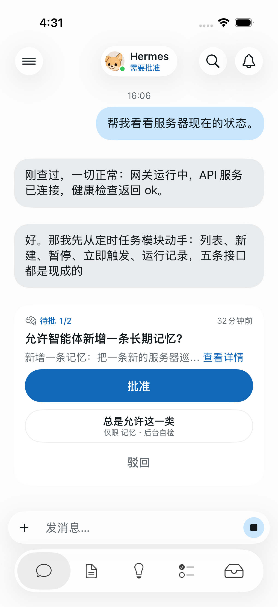
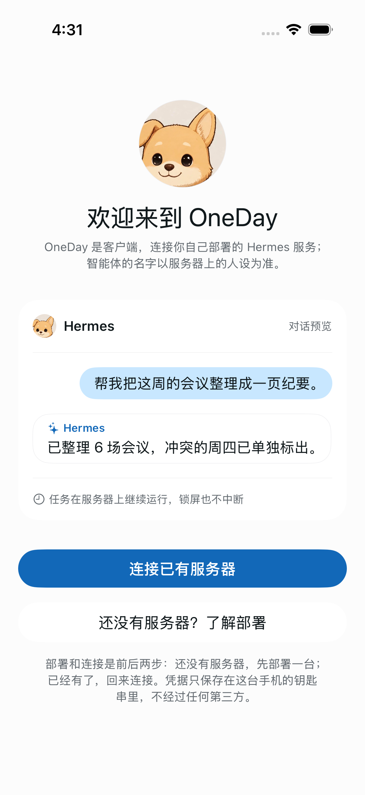
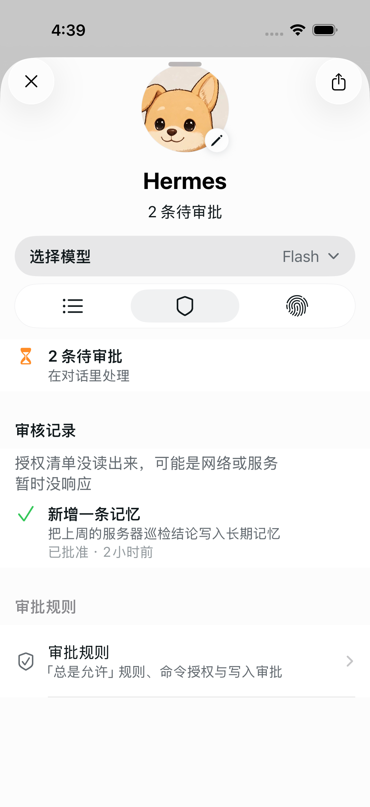

# OneDay — an open-source Muse, running on your own Hermes


**OneDay is an open-source Muse: a personal AI agent that lives on your own server.**

Commercial personal AI assistants run your agent — and keep your data — on someone else's cloud. OneDay flips that around. The agent is **Hermes**, self-hosted on a server you control, and OneDay is its full-featured, fully native iOS client: chat with your agent, watch it work, approve its actions, browse its files and manage its models from your iPhone. No third-party cloud in the middle — the app talks directly to *your* server over its API.

## Why "OneDay"?

"One day…" is how every wish begins — *one day I'll start, one day I'll change, one day I'll get there.* OneDay pulls that day back to today: start today, and live every day well, one day at a time.

> **Status:** OneDay is in active development, with new releases shipping regularly (current line: 0.51.x). It's open source under MIT and maintained by its original author; issues, PRs and co-maintainers are all welcome — see the [help-wanted issues](https://github.com/yyyyymmmmm/oneday-app/issues?q=is%3Aissue+is%3Aopen+label%3A%22help+wanted%22) if you'd like to pick something up, or open an issue to say hello.

## Screenshots

<p>
  
  
  
</p>

<sub>Screenshots are from an earlier release and are being re-shot for the current interface.</sub>

## Features

- **Streaming chat** with block-level rendering, tool-call cards, image lightbox and file preview
- **Approvals** — a dedicated approval card pinned above the input bar: the agent asks, you approve, deny or always-allow in one tap, with a full audit ledger
- **Sessions & channels** — your conversations, plus sessions that arrive from the web/API side, all resumable
- **Work ledger** — every background/scheduled task the agent runs, with live status
- **Files** — browse, preview and manage the agent's working files
- **Feed, Ideas, Goals** — the agent keeps an eye on the world for you, proposes next steps, and tracks your goals
- **Model & provider management** — bring your own providers and model line-ups, switch per session
- **Voice dictation** and on-device connectors (calendar, contacts, reminders, health summaries) with a strict one-switch-per-dataset privacy model
- **iOS 26 native design** — Liquid Glass surfaces, a token-driven design system, full Dark Mode and Dynamic Type support
- **Self-hosted first** — in-app setup wizard: paste your server address and key, the app verifies the connection, done

## Requirements

- A running **Hermes server (v0.23.0)** — see `docs/API-SURFACE.md` for the exact API surface this client is built and tested against
- iPhone with **iOS 26+**
- To build: Xcode 26 + [Tuist](https://tuist.dev)

## Build & run

```sh
tuist generate   # generates OneDay.xcodeproj
```

Open the project in Xcode, pick the `OneDayApp` scheme, run. Unit tests live in `OneDayCoreTests`.

On first launch the app asks only for your Hermes server address and your login key — everything else is configured in-app.

## Project layout

- `Sources/OneDayCore` — pure logic: URL normalization, API models, SSE parsing, error taxonomy
- `Sources/OneDayDesign` — design tokens and base components
- `Sources/OneDayApp` — UI and networking: connect flow, chat, hub, files, settings
- `Tests/OneDayCoreTests` — unit tests for the core
- `docs/` — API surface notes and design records

## 中文简介

**OneDay 是开源版的 Muse：一个住在你自己服务器上的个人智能体。**

商业个人 AI 助手把你的智能体、连同你的数据，一起放在别人的云上。OneDay 反过来：智能体是自托管的 **Hermes**，跑在你自己的服务器上；OneDay 是它的全原生 iOS 客户端——跟它聊天、看它干活、批它的审批、管它的文件和模型，中间不经过任何第三方云，App 直连你自己的服务器。

### 为什么叫 OneDay

「One day」是每个人许愿时的话——总有一天我会怎样。OneDay 想把那一天拉回今天：从今天开始，陪你过好每一天。

项目由原作者持续开发中，版本持续更新（当前 0.51.x 线），MIT 开源。欢迎从 [help wanted issue](https://github.com/yyyyymmmmm/oneday-app/issues) 里挑一个上手，或直接开 issue 报名共同维护。

## Contributing

PRs and new maintainers are welcome — start with [CONTRIBUTING.md](CONTRIBUTING.md).

## License

MIT — see [LICENSE](LICENSE).
